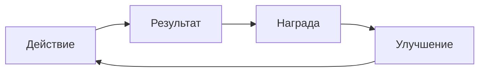
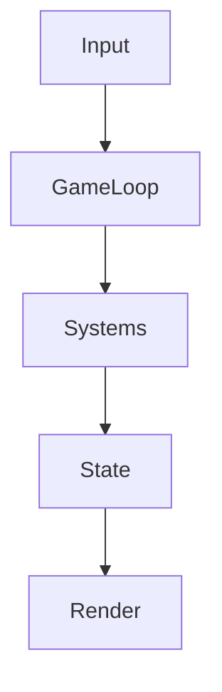

# {{title}} — MVP

> [!abstract] Pitch в одном абзаце
> Что это за игра, для кого, в чём главное удовольствие и чем MVP докажет, что в неё интересно играть.

## 1. Концепт

### 1.1 High concept
<!-- 1–2 предложения: жанр + фишка + настроение -->

### 1.2 Pillars (3–5 столпов дизайна)
1. **Столп 1:** 
2. **Столп 2:** 
3. **Столп 3:** 
<!-- Любая фича должна служить хотя бы одному столпу -->

### 1.3 Целевая аудитория
| Сегмент | Что любят играть | Сессия (мин) | Платформа | Приоритет |
|---|---|---|---|---|
|  |  |  |  |  |

### 1.4 Референсы и отличия
| Игра | Что берём | Что делаем иначе |
|---|---|---|
|  |  |  |

### 1.5 Гипотезы, которые проверяет MVP
- [ ] **H1:** Игрокам интересно ..., потому что ...
- [ ] **H2:** Core loop удерживает ... минут без награды извне
- [ ] **H3:** 

## 2. Цели MVP и метрики

| Цель | Метрика | Целевое значение | Как измеряем |
|---|---|---|---|
| Удержание | D1 / D7 |  | аналитика |
| Вовлечённость | Длина сессии |  | аналитика |
| Понятность | Прошли туториал без помощи |  | плейтест |
| Fun | Оценка игроков (1–5) |  | опрос после плейтеста |

> [!question] Критерий успеха MVP
> Что должно случиться, чтобы идти в полный продакшн. И что — чтобы остановиться или переделать концепт.

## 3. Границы MVP

### 3.1 Входит (vertical slice)
- 

### 3.2 Не входит
- 

### 3.3 Отложено после MVP
| Идея | Почему не сейчас | Условие возврата |
|---|---|---|
|  |  |  |

## 4. Геймплей

### 4.1 Core loop

<!-- Опиши цикл на 30 секунд, на сессию и на неделю (meta loop) -->

### 4.2 Управление и камера
- Ввод:
- Камера / вид:

### 4.3 Механики
| ID | Механика | Описание | Связь со столпом | Приоритет |
|---|---|---|---|---|
| M-1 |  |  |  | Must |

### 4.4 Правила, победа и поражение
- Цель игрока:
- Условия победы:
- Условия поражения / штрафы:

### 4.5 Прогрессия и баланс
- Что растёт (уровень, предметы, навыки):
- Кривая сложности:
- Ключевые числа (HP, урон, награды, тайминги):

### 4.6 Экономика
| Ресурс | Источник | Сток | Мягкая / жёсткая валюта |
|---|---|---|---|
|  |  |  |  |

### 4.7 Онбординг и туториал
- Первые 5 минут игры:
- Как игрок учится механикам:

## 5. Контент

### 5.1 Мир, сюжет, персонажи
- Сеттинг:
- Сюжет (если есть):
- Персонажи:

### 5.2 Уровни / игровые режимы
| Уровень / режим | Назначение | Длительность | Статус |
|---|---|---|---|
|  |  |  | todo |

### 5.3 Объём контента в MVP
| Тип | Кол-во в MVP | Комментарий |
|---|---|---|
| Уровни |  |  |
| Враги / NPC |  |  |
| Предметы |  |  |

## 6. Арт и звук

### 6.1 Визуальный стиль
- Референсы, палитра, настроение:
- Разрешение, формат ассетов:

### 6.2 UI / UX
- Основные экраны: меню, HUD, пауза, настройки
- Макеты: 

### 6.3 Аудио
- Музыка, SFX, озвучка:

### 6.4 Пайплайн ассетов
- Откуда берём (свои / сток / заказ):
- Именование и импорт в движок:

## 7. Техническая архитектура

### 7.1 Движок и стек
| Слой | Выбор | Альтернативы | Обоснование |
|---|---|---|---|
| Движок |  |  |  |
| Язык |  |  |  |
| Backend (если нужен) |  |  |  |
| Аналитика |  |  |  |

### 7.2 Архитектура клиента

<!-- Паттерн: ECS / компонентный / MVC / state machine; где живёт состояние -->

### 7.3 Backend и сеть (если есть)
- Что хранится на сервере (профиль, прогресс, лидерборды):
- Мультиплеер: модель (authoritative / p2p), тикрейт, синхронизация:
- API-контракты:

### 7.4 Данные и сохранения
- Формат сохранений, версионирование:
- Конфиги баланса (data-driven):

### 7.5 Производительность и платформы
| Платформа | Мин. устройство | Целевой FPS | Бюджет памяти | Размер билда |
|---|---|---|---|---|
|  |  |  |  |  |

### 7.6 Инструменты разработки
- Репозиторий и ветвление:
- CI/CD и сборки (TestFlight, internal track и т.д.):
- Дебаг-инструменты, читы для тестов:

### 7.7 Архитектурные решения (ADR)
| ID | Решение | Статус | Ссылка |
|---|---|---|---|
| ADR-001 |  | proposed | [[ADR-001]] |

## 8. Монетизация и аналитика

- Модель в MVP (бесплатно / премиум / без монетизации):
- События аналитики (воронка, ключевые действия):
- Приватность и согласия (GDPR, возраст, ПДн):

## 9. Тестирование и плейтесты

- Стратегия QA (ручное, автотесты логики, смоук-чеклист):
- Плейтесты: кто, сколько, на каких устройствах:
- Что наблюдаем: где застревают, где бросают, где смеются

| Плейтест | Дата | Кол-во игроков | Главные выводы | Что меняем |
|---|---|---|---|---|
|  |  |  |  |  |

## 10. Допущения, ограничения, зависимости
### Допущения
- 
### Ограничения (бюджет, сроки, команда, платформы)
- 
### Зависимости (лицензии, сторонние SDK, магазины)
- 

## 11. Риски

| ID | Риск | Вероятность | Влияние | Митигация | Владелец |
|---|---|---|---|---|---|
| R-1 | Core loop не «заходит» | M | H | Ранний прототип, плейтест на 2-й неделе |  |
| R-2 | Раздутый scope | H | H | Жёсткий список «Не входит» |  |

## 12. План и вехи

| Веха | Содержание | Дата | Критерий готовности |
|---|---|---|---|
| Prototype | Серый бокс, core loop играбелен |  | Интересно играть 5 минут |
| Vertical slice | Один уровень с финальным качеством |  | Показываем стейкхолдерам |
| Alpha | Весь контент MVP, баги допустимы |  | Игра проходится от начала до конца |
| Beta | Баланс, полировка, плейтесты |  | Метрики плейтеста в норме |
| Release MVP | Публикация / закрытый тест |  | Билд в сторе / у тестеров |

### Эпики
- [ ] Эпик 1: Core loop
- [ ] Эпик 2: Управление и камера
- [ ] Эпик 3: Первый уровень
- [ ] Эпик 4: UI и туториал
- [ ] Эпик 5: Сохранения и аналитика

## 13. Команда и ответственность

| Роль | Кто | Зона ответственности |
|---|---|---|
| Геймдизайн |  |  |
| Разработка |  |  |
| Арт |  |  |
| Звук |  |  |
| QA |  |  |
| Продюсирование |  |  |

## 14. Открытые вопросы
- [ ] Вопрос — кто отвечает — до какой даты

## 15. Глоссарий
| Термин | Определение |
|---|---|
|  |  |

## 16. Связанные материалы
- [[Pitch]]
- [[Исследование рынка и референсов]]
- [[Арт-библия]]
- Прототип / билд:
- Репозиторий:
- Трекер задач:

## История изменений
| Версия | Дата | Автор | Изменения |
|---|---|---|---|
| 0.1 | {{date}} |  | Первый черновик |
